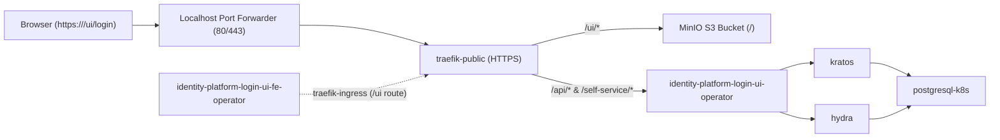

# Manual Deployment Guide (Traefik): Identity Platform Login UI (Frontend & Backend Operators)

This document provides step-by-step instructions to deploy and verify the **Identity Platform Login UI Frontend Operator** (`identity-platform-login-ui-fe-operator`) alongside the refactored **Identity Platform Login UI Operator** (`identity-platform-login-ui-operator`, branch `refactor/remove-ui-endpoints`) and the complete Canonical Identity and Access Management (IAM) stack on Kubernetes using Juju and **Traefik** (`traefik-k8s`).

---

## Architecture Overview

In this decoupled architecture:
- **`identity-platform-login-ui-fe-operator`** configures `traefik-public` to proxy `/ui/*` requests directly to a static Next.js bundle hosted on an S3-compatible object storage service (MinIO) over HTTPS, injecting the required security and caching headers (`Content-Security-Policy`, `X-Frame-Options`, `Cache-Control`, etc.).
- **`identity-platform-login-ui-operator`** (`refactor/remove-ui-endpoints`) exposes only the backend endpoints (`/api/...` and `/self-service`) via `traefik-public` and provides the UI endpoint URLs to Kratos and Hydra via the `ui-endpoint-info` integration.



---

## Prerequisites

Ensure the following tools and artefacts are available on your machine:
- **Juju** (`3.x`) bootstrapped on a Kubernetes cluster (e.g. `canonical-k8s`)
- **Charmcraft** (`3.x` / `4.x`)
- **kubectl** configured to access the Kubernetes cluster
- **OpenSSL** (for generating MinIO TLS certificates)
- **Next.js Static UI Bundle**: built static files directory (generated via `npm run build` / `next export`)
- **Backend Charm**: pre-packed `identity-platform-login-ui-operator` charm built from the `refactor/remove-ui-endpoints` branch

---

## Environment Variables

All commands in this guide are parameterised using environment variables. Review the table below and export the variables in your shell session before running the deployment steps.

| Variable | Description | Example / Default Value |
| :--- | :--- | :--- |
| `JUJU_MODEL` | Name of the Juju model (and Kubernetes namespace) | `iam-manual-test` |
| `ARCH` | Target architecture for packing and Juju model constraints | `amd64` |
| `UBUNTU_BASE` | Target Ubuntu base for `charmcraft pack` | `ubuntu@22.04` |
| `EXTERNAL_HOSTNAME` | Public hostname configured on the ingress controller | `localhost` |
| `FRONTEND_REPO_DIR` | Path to the `identity-platform-login-ui-frontend-operator` repository | `/home/barco/PycharmProjects/identity-platform-login-ui-frontend-operator` |
| `FRONTEND_CHARM_PATH` | Path to the packed frontend operator `.charm` file | `${FRONTEND_REPO_DIR}/identity-platform-login-ui-fe-operator_${UBUNTU_BASE}-${ARCH}.charm` |
| `FRONTEND_APP_NAME` | Juju application name for the frontend operator | `identity-platform-login-ui-fe-operator` |
| `BACKEND_REPO_DIR` | Path to the `identity-platform-login-ui-operator` repository | `/home/barco/PycharmProjects/identity-platform-login-ui-operator` |
| `BACKEND_CHARM_PATH` | Path to the packed backend operator `.charm` file | `${BACKEND_REPO_DIR}/identity-platform-login-ui-operator_${UBUNTU_BASE}-${ARCH}.charm` |
| `BACKEND_APP_NAME` | Juju application name for the backend operator | `identity-platform-login-ui-operator` |
| `BACKEND_OCI_IMAGE` | OCI container image for `identity-platform-login-ui-operator` | `ghcr.io/canonical/identity-platform-login-ui:v0.28.0` |
| `UI_DIST_DIR` | Local directory containing the built Next.js static files (`index.html`, `login.html`, `_next/...`) | `/home/barco/GolandProjects/identity-platform-login-ui-frontend/dist` |
| `TRAEFIK_PUBLIC_APP` | Juju application name for the public Traefik ingress | `traefik-public` |
| `MINIO_APP_NAME` | Juju application name for MinIO | `minio` |
| `MINIO_PORT` | MinIO S3 API port | `9000` |
| `MINIO_ACCESS_KEY` | MinIO administrator access key | `minioadmin` |
| `MINIO_SECRET_KEY` | MinIO administrator secret key | `minioadmin` |
| `MINIO_BUCKET` | S3 bucket name for the static UI bundle | `login-ui-bundle` |
| `MINIO_BUNDLE_PREFIX` | Folder prefix inside the S3 bucket containing `index.html` | `dist` |
| `MINIO_FQDN` | Internal Kubernetes FQDN (Common Name / SAN for MinIO TLS cert) | `${MINIO_APP_NAME}.${JUJU_MODEL}.svc.cluster.local` |
| `MINIO_CERT_PATH` | Path to the generated MinIO TLS certificate (`.crt`) | `/tmp/minio-${JUJU_MODEL}.crt` |
| `MINIO_KEY_PATH` | Path to the generated MinIO TLS private key (`.key`) | `/tmp/minio-${JUJU_MODEL}.key` |
| `UI_BUNDLE_URL` | Full HTTPS URL to the static UI bundle on S3/MinIO | `https://${MINIO_FQDN}:${MINIO_PORT}/${MINIO_BUCKET}/${MINIO_BUNDLE_PREFIX}` |
| `TEST_ADMIN_EMAIL` | Email address for the test Kratos identity | `admin@example.com` |
| `TEST_ADMIN_USERNAME` | Username for the test Kratos identity | `admin` |
| `TEST_ADMIN_PASSWORD` | Password for the test Kratos identity | `SecretPassword123!` |

### Export Environment Variables

Copy, customise if needed, and run the following block in your terminal:

```bash
# Model & platform settings
export JUJU_MODEL="iam-manual-test"
export ARCH="amd64"
export UBUNTU_BASE="ubuntu@22.04"
export EXTERNAL_HOSTNAME="localhost"

# Repositories, charm artefacts & application names
export FRONTEND_REPO_DIR="/home/barco/PycharmProjects/identity-platform-login-ui-frontend-operator"
export FRONTEND_CHARM_PATH="${FRONTEND_REPO_DIR}/identity-platform-login-ui-fe-operator_${UBUNTU_BASE}-${ARCH}.charm"
export FRONTEND_APP_NAME="identity-platform-login-ui-fe-operator"

export BACKEND_REPO_DIR="/home/barco/PycharmProjects/identity-platform-login-ui-operator"
export BACKEND_CHARM_PATH="${BACKEND_REPO_DIR}/identity-platform-login-ui-operator_${UBUNTU_BASE}-${ARCH}.charm"
export BACKEND_APP_NAME="identity-platform-login-ui-operator"
export BACKEND_OCI_IMAGE="ghcr.io/canonical/identity-platform-login-ui:v0.28.0"

export UI_DIST_DIR="/home/barco/GolandProjects/identity-platform-login-ui-frontend/dist"
export TRAEFIK_PUBLIC_APP="traefik-public"

# MinIO / S3 bundle configuration
export MINIO_APP_NAME="minio"
export MINIO_PORT="9000"
export MINIO_ACCESS_KEY="minioadmin"
export MINIO_SECRET_KEY="minioadmin"
export MINIO_BUCKET="login-ui-bundle"
export MINIO_BUNDLE_PREFIX="dist"
export MINIO_FQDN="${MINIO_APP_NAME}.${JUJU_MODEL}.svc.cluster.local"
export MINIO_CERT_PATH="/tmp/minio-${JUJU_MODEL}.crt"
export MINIO_KEY_PATH="/tmp/minio-${JUJU_MODEL}.key"
export UI_BUNDLE_URL="https://${MINIO_FQDN}:${MINIO_PORT}/${MINIO_BUCKET}/${MINIO_BUNDLE_PREFIX}"

# Test user credentials
export TEST_ADMIN_EMAIL="admin@example.com"
export TEST_ADMIN_USERNAME="admin"
export TEST_ADMIN_PASSWORD="SecretPassword123!"
```

---

## Step 1: Pack the Charms

### 1.1 Pack the Frontend Operator Charm
From the frontend operator repository root, pack the charm for `${UBUNTU_BASE}:${ARCH}`:

```bash
cd "${FRONTEND_REPO_DIR}"
charmcraft pack --platform "${UBUNTU_BASE}:${ARCH}"
```

### 1.2 Locate or Pack the Backend Operator Charm
Verify that the backend charm built from the `refactor/remove-ui-endpoints` branch exists at `${BACKEND_CHARM_PATH}`, or pack it if needed:

```bash
ls -lh "${BACKEND_CHARM_PATH}"
```

---

## Step 2: Create the Juju Model

Create the Juju model `${JUJU_MODEL}` and configure the architecture constraint:

```bash
juju add-model "${JUJU_MODEL}"
juju set-model-constraints arch="${ARCH}"
```

---

## Step 3: Deploy and Configure MinIO (S3 Storage over HTTPS)

Because `${FRONTEND_APP_NAME}` requires an `https://` URL for `ui-bundle-url`, MinIO must be configured with a TLS certificate valid for `${MINIO_FQDN}`.

### 3.1 Generate a Self-Signed Certificate for MinIO
```bash
openssl req -x509 -newkey rsa:2048 -nodes \
  -keyout "${MINIO_KEY_PATH}" \
  -out "${MINIO_CERT_PATH}" \
  -days 365 \
  -subj "/CN=${MINIO_FQDN}" \
  -addext "subjectAltName=DNS:${MINIO_FQDN},DNS:${MINIO_APP_NAME},DNS:localhost"
```

### 3.2 Deploy MinIO with TLS Enabled
```bash
juju deploy minio "${MINIO_APP_NAME}" --channel ckf-1.9/stable --trust \
  --config access-key="${MINIO_ACCESS_KEY}" \
  --config secret-key="${MINIO_SECRET_KEY}" \
  --config ssl-cert="$(base64 -w0 "${MINIO_CERT_PATH}")" \
  --config ssl-key="$(base64 -w0 "${MINIO_KEY_PATH}")"
```

---

## Step 4: Deploy the IAM Stack and Login UI Charms

### 4.1 Deploy Core IAM Components
```bash
# Traefik Ingress Controller
juju deploy traefik-k8s "${TRAEFIK_PUBLIC_APP}" --channel latest/stable --trust \
  --config external_hostname="${EXTERNAL_HOSTNAME}"

# Self-Signed Certificates Operator
juju deploy self-signed-certificates --channel 1/stable

# PostgreSQL Database (with required Kratos/Hydra extensions enabled)
juju deploy postgresql-k8s --channel 14/stable --trust \
  --config plugin_pg_trgm_enable=True \
  --config plugin_btree_gin_enable=True

# Ory Kratos & Ory Hydra
juju deploy kratos --channel latest/edge --trust --config dev=True
juju deploy hydra --channel latest/edge --trust --config dev=True
```

### 4.2 Deploy the Login UI Backend & Frontend Charms
```bash
# Backend Login UI Operator (from branch refactor/remove-ui-endpoints)
juju deploy "${BACKEND_CHARM_PATH}" "${BACKEND_APP_NAME}" --trust \
  --resource oci-image="${BACKEND_OCI_IMAGE}"

# Frontend Login UI Operator (current branch)
juju deploy "${FRONTEND_CHARM_PATH}" "${FRONTEND_APP_NAME}" --trust \
  --config ui-bundle-url="${UI_BUNDLE_URL}"
```

---

## Step 5: Trust the MinIO TLS Certificate in Traefik and the Frontend Charm

Both the `traefik` workload container in `${TRAEFIK_PUBLIC_APP}/0` (which proxies requests to MinIO) and `${FRONTEND_APP_NAME}/0` (which validates `${UI_BUNDLE_URL}` reachability) must trust the MinIO self-signed certificate.

Wait until `${TRAEFIK_PUBLIC_APP}/0`, `${MINIO_APP_NAME}/0`, and `${FRONTEND_APP_NAME}/0` are running, then execute:

```bash
# 1. Trust MinIO certificate inside the traefik workload container
kubectl cp "${MINIO_CERT_PATH}" \
  "${JUJU_MODEL}/${TRAEFIK_PUBLIC_APP}-0:/usr/local/share/ca-certificates/minio.crt" -c traefik
juju ssh --container traefik "${TRAEFIK_PUBLIC_APP}/0" \
  "update-ca-certificates && /charm/bin/pebble restart traefik"

# 2. Trust MinIO certificate inside the frontend operator unit
kubectl cp "${MINIO_CERT_PATH}" \
  "${JUJU_MODEL}/${FRONTEND_APP_NAME}-0:/usr/local/share/ca-certificates/minio.crt" -c charm
juju ssh "${FRONTEND_APP_NAME}/0" "update-ca-certificates"
```

---

## Step 6: Upload the Next.js Static Bundle to MinIO

Create the `${MINIO_BUCKET}` bucket on MinIO, enable anonymous read access, and upload all static files from `${UI_DIST_DIR}` into `s3://${MINIO_BUCKET}/${MINIO_BUNDLE_PREFIX}`:

```bash
kubectl exec -n "${JUJU_MODEL}" "${MINIO_APP_NAME}-0" -c minio -- sh -c \
  "mc alias set local https://localhost:${MINIO_PORT} ${MINIO_ACCESS_KEY} ${MINIO_SECRET_KEY} --insecure && \
   mc mb --ignore-existing local/${MINIO_BUCKET} --insecure && \
   mc anonymous set download local/${MINIO_BUCKET} --insecure"

kubectl cp "${UI_DIST_DIR}" \
  "${JUJU_MODEL}/${MINIO_APP_NAME}-0:/tmp/${MINIO_BUNDLE_PREFIX}" -c minio

kubectl exec -n "${JUJU_MODEL}" "${MINIO_APP_NAME}-0" -c minio -- \
  mc cp --recursive "/tmp/${MINIO_BUNDLE_PREFIX}" "local/${MINIO_BUCKET}/" --insecure
```

> **Note:** If `${FRONTEND_APP_NAME}/0` evaluated its status before the files were uploaded, re-trigger its health check by running `juju config "${FRONTEND_APP_NAME}" ui-bundle-url="${UI_BUNDLE_URL}"`.

---

## Step 7: Integrate the Charms

Establish all required Juju integrations between the database, certificates, ingress, Kratos, Hydra, and the two Login UI charms:

```bash
# Database integrations
juju integrate postgresql-k8s:database kratos:pg-database
juju integrate postgresql-k8s:database hydra:pg-database

# TLS certificates for Public Traefik and CA transfer
juju integrate self-signed-certificates:certificates "${TRAEFIK_PUBLIC_APP}:certificates"
juju integrate self-signed-certificates:send-ca-cert kratos:receive-ca-cert
juju integrate self-signed-certificates:send-ca-cert "${BACKEND_APP_NAME}:receive-ca-cert"

# Public Ingress routes
juju integrate "${TRAEFIK_PUBLIC_APP}:traefik-route" kratos:public-route
juju integrate "${TRAEFIK_PUBLIC_APP}:traefik-route" hydra:public-route
juju integrate "${TRAEFIK_PUBLIC_APP}:traefik-route" "${BACKEND_APP_NAME}:public-route"
juju integrate "${TRAEFIK_PUBLIC_APP}:traefik-route" "${FRONTEND_APP_NAME}:traefik-ingress"

# IAM internal & UI endpoint integrations
juju integrate hydra:hydra-endpoint-info kratos:hydra-endpoint-info
juju integrate hydra:hydra-endpoint-info "${BACKEND_APP_NAME}:hydra-endpoint-info"
juju integrate kratos:kratos-info "${BACKEND_APP_NAME}:kratos-info"
juju integrate "${BACKEND_APP_NAME}:ui-endpoint-info" kratos:ui-endpoint-info
juju integrate "${BACKEND_APP_NAME}:ui-endpoint-info" hydra:ui-endpoint-info
```

Wait until all units settle into `active` / `idle`:

```bash
juju status --watch 2s
```

---

## Step 8: Expose `${TRAEFIK_PUBLIC_APP}` on `localhost` (Ports 80 & 443)

When `EXTERNAL_HOSTNAME` is `localhost`, Kratos and the Login UI backend redirect browser flows to `https://localhost/ui/...`. To forward `127.0.0.1:80` and `127.0.0.1:443` on the host machine to the `${TRAEFIK_PUBLIC_APP}-lb` service without requiring `sudo` on the host, deploy a lightweight forwarding pod using `hostNetwork: true`:

```bash
TRAEFIK_CLUSTER_IP=$(kubectl get svc -n "${JUJU_MODEL}" "${TRAEFIK_PUBLIC_APP}-lb" -o jsonpath='{.spec.clusterIP}')

kubectl apply -n "${JUJU_MODEL}" -f - << EOF
apiVersion: v1
kind: Pod
metadata:
  name: localhost-forwarder
  namespace: ${JUJU_MODEL}
spec:
  hostNetwork: true
  dnsPolicy: ClusterFirstWithHostNet
  containers:
  - name: socat-80
    image: alpine/socat:latest
    args: ["TCP-LISTEN:80,bind=127.0.0.1,fork,reuseaddr", "TCP:${TRAEFIK_CLUSTER_IP}:80"]
  - name: socat-443
    image: alpine/socat:latest
    args: ["TCP-LISTEN:443,bind=127.0.0.1,fork,reuseaddr", "TCP:${TRAEFIK_CLUSTER_IP}:443"]
EOF
```

---

## Step 9: Verification and Testing

### 9.1 Verify Endpoints via CLI
```bash
# 1. Verify static UI page served by MinIO via Traefik (with security headers)
curl -k -I "https://${EXTERNAL_HOSTNAME}/ui/login"

# 2. Verify backend API served by identity-platform-login-ui-operator
curl -k -I "https://${EXTERNAL_HOSTNAME}/api/v0/app-config"

# 3. Verify Kratos browser login flow initialisation and redirect to /ui/login?flow=<uuid>
curl -k -I "https://${EXTERNAL_HOSTNAME}/self-service/login/browser?return_to=/ui/login"
```

### 9.2 Create a Test Identity in Kratos
To test logging in or resetting credentials in the browser, create an account using the Kratos charm action:

```bash
juju run kratos/0 create-admin-account \
  email="${TEST_ADMIN_EMAIL}" \
  password="${TEST_ADMIN_PASSWORD}" \
  username="${TEST_ADMIN_USERNAME}"
```

### 9.3 Test in the Browser
Open your browser and navigate to:
- **Login page**: `https://${EXTERNAL_HOSTNAME}/ui/login`
- **Root UI page**: `https://${EXTERNAL_HOSTNAME}/ui/`
- **Recovery link**: Use the `recovery-link` returned by the `create-admin-account` action above.
