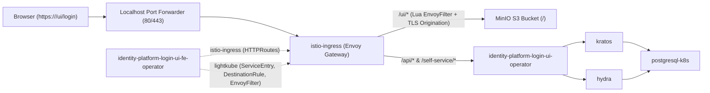

# Manual Deployment Guide (Istio): Identity Platform Login UI (Frontend & Backend Operators)

This document provides step-by-step instructions to deploy and verify the **Identity Platform Login UI Frontend Operator** (`identity-platform-login-ui-fe-operator`) alongside the **Identity Platform Login UI Operator** (`identity-platform-login-ui-operator`, Istio track with `/ui` endpoints removed) and the Canonical Identity and Access Management (IAM) stack on Kubernetes using **Istio** (`istio-k8s` and `istio-ingress-k8s`) instead of Traefik.

---

## Architecture Overview

When deployed with Istio:
- **`istio-k8s`** provides the Istio control plane (`istiod`) and installs the Istio and Gateway API Custom Resource Definitions (CRDs).
- **`istio-ingress-k8s`** (`istio-ingress`) manages the Envoy-based Istio Ingress Gateway pod.
- **`identity-platform-login-ui-fe-operator`**:
  1. Integrates with `istio-ingress` over the `istio_ingress_route` interface (`istio-ingress` relation) to configure Kubernetes Gateway API `HTTPRoute` resources for `/ui`, `/ui/`, `/ui/<page>`, and `/ui/<assets>`.
  2. Uses `lightkube` to dynamically reconcile Istio mesh resources in the cluster:
     - **`ServiceEntry` & `DestinationRule`** (`<FRONTEND_APP_NAME>-s3-external`): configures TLS origination from the Istio Gateway to the external S3-compatible object storage service (MinIO).
     - **`EnvoyFilter`** (`<FRONTEND_APP_NAME>-ui-rewrite`): injects a Lua HTTP filter on the Gateway to rewrite extensionless page routes (`/ui/login` → `<base>/login.html`), redirect trailing slashes (`/ui/login/` → `/ui/login`), rewrite asset paths, and attach the required security and cache-control headers (`Content-Security-Policy`, `X-Frame-Options`, `Cache-Control`, etc.).
- **`identity-platform-login-ui-operator`** (Istio branch with `/ui` removed from `public-route`) exposes only `/api/...` and `/self-service` via `istio-ingress-route` and provides the UI endpoint URLs to Kratos and Hydra via `ui-endpoint-info`.



---

## Prerequisites

Ensure the following tools and artefacts are available on your machine:
- **Juju** (`3.x`) bootstrapped on a Kubernetes cluster (e.g. `canonical-k8s`)
- **Charmcraft** (`3.x` / `4.x`)
- **kubectl** configured to access the Kubernetes cluster
- **OpenSSL** (for generating MinIO TLS certificates)
- **Next.js Static UI Bundle**: built static files directory (generated via `npm run build` / `next export`)
- **Backend Charm (Istio track)**: `identity-platform-login-ui-operator` built from the Istio track (`track/istio` with the `/ui` `HTTPRoute` match removed from `src/integrations.py`)

---

## Environment Variables

All commands in this guide are parameterised using environment variables. Review the table below and export the variables in your shell session before running the deployment steps.

| Variable | Description | Example / Default Value |
| :--- | :--- | :--- |
| `JUJU_MODEL` | Name of the Juju model (and Kubernetes namespace) | `iam-istio-test` |
| `ARCH` | Target architecture for packing and Juju model constraints | `amd64` |
| `UBUNTU_BASE` | Target Ubuntu base for `charmcraft pack` | `ubuntu@22.04` |
| `EXTERNAL_HOSTNAME` | Public hostname configured on the Istio ingress gateway | `localhost` |
| `ISTIO_APP` | Juju application name for the `istio-k8s` control plane | `istio-k8s` |
| `ISTIO_INGRESS_APP` | Juju application name for the `istio-ingress-k8s` gateway | `istio-ingress` |
| `ISTIO_CHANNEL` | Charmhub channel for `istio-k8s` and `istio-ingress-k8s` | `2/edge` |
| `ISTIO_RESOURCES_NAMESPACE` | Namespace where the Istio Gateway pod and `EnvoyFilter` resources reside | `${JUJU_MODEL}` |
| `FRONTEND_REPO_DIR` | Path to the `identity-platform-login-ui-frontend-operator` repository | `/home/barco/PycharmProjects/identity-platform-login-ui-frontend-operator` |
| `FRONTEND_CHARM_PATH` | Path to the packed frontend operator `.charm` file | `${FRONTEND_REPO_DIR}/identity-platform-login-ui-fe-operator_${UBUNTU_BASE}-${ARCH}.charm` |
| `FRONTEND_APP_NAME` | Juju application name for the frontend operator | `identity-platform-login-ui-fe-operator` |
| `BACKEND_REPO_DIR` | Path to the `identity-platform-login-ui-operator` repository | `/home/barco/PycharmProjects/identity-platform-login-ui-operator` |
| `BACKEND_CHARM_PATH` | Path to the packed backend operator `.charm` file (Istio branch) | `${BACKEND_REPO_DIR}/identity-platform-login-ui-operator_${UBUNTU_BASE}-${ARCH}.charm` |
| `BACKEND_APP_NAME` | Juju application name for the backend operator | `identity-platform-login-ui-operator` |
| `BACKEND_OCI_IMAGE` | OCI container image for `identity-platform-login-ui-operator` | `ghcr.io/canonical/identity-platform-login-ui:v0.28.0` |
| `UI_DIST_DIR` | Local directory containing the built Next.js static files (`index.html`, `login.html`, `_next/...`) | `/home/barco/GolandProjects/identity-platform-login-ui-frontend/dist` |
| `MINIO_APP_NAME` | Juju application name for MinIO | `minio` |
| `MINIO_PORT` | MinIO S3 API port | `9000` |
| `MINIO_ACCESS_KEY` | MinIO administrator access key | `minioadmin` |
| `MINIO_SECRET_KEY` | MinIO administrator secret key | `minioadmin` |
| `MINIO_BUCKET` | S3 bucket name for the static UI bundle | `login-ui-bundle` |
| `MINIO_BUNDLE_PREFIX` | Folder prefix inside the S3 bucket containing `index.html` | `dist` |
| `MINIO_FQDN` | Internal Kubernetes FQDN (Common Name / SAN for MinIO TLS cert) | `${MINIO_APP_NAME}.${JUJU_MODEL}.svc.cluster.local` |
| `MINIO_CERT_PATH` | Path to the generated MinIO TLS certificate (`.crt`) | `/tmp/minio-${JUJU_MODEL}.crt` |
| `MINIO_KEY_PATH` | Path to the generated MinIO TLS private key (`.key`) | `/tmp/minio-${JUJU_MODEL}.key` |
| `UI_BUNDLE_URL` | Full HTTPS URL to the static UI bundle on S3/MinIO | `https://${MINIO_FQDN}:${MINIO_PORT}/${MINIO_BUCKET}/${MINIO_BUNDLE_PREFIX}` |
| `S3_EXTERNAL_SERVICE_FQDN` | Synthetic Istio `ServiceEntry` FQDN created by the frontend operator | `${FRONTEND_APP_NAME}-s3-external.${JUJU_MODEL}.svc.cluster.local` |
| `TEST_ADMIN_EMAIL` | Email address for the test Kratos identity | `admin@example.com` |
| `TEST_ADMIN_USERNAME` | Username for the test Kratos identity | `admin` |
| `TEST_ADMIN_PASSWORD` | Password for the test Kratos identity | `SecretPassword123!` |

### Export Environment Variables

Copy, customise if needed, and run the following block in your terminal:

```bash
# Model & platform settings
export JUJU_MODEL="iam-istio-test"
export ARCH="amd64"
export UBUNTU_BASE="ubuntu@22.04"
export EXTERNAL_HOSTNAME="localhost"

# Istio settings
export ISTIO_APP="istio-k8s"
export ISTIO_INGRESS_APP="istio-ingress"
export ISTIO_CHANNEL="2/edge"
export ISTIO_RESOURCES_NAMESPACE="${JUJU_MODEL}"

# Repositories, charm artefacts & application names
export FRONTEND_REPO_DIR="/home/barco/PycharmProjects/identity-platform-login-ui-frontend-operator"
export FRONTEND_CHARM_PATH="${FRONTEND_REPO_DIR}/identity-platform-login-ui-fe-operator_${UBUNTU_BASE}-${ARCH}.charm"
export FRONTEND_APP_NAME="identity-platform-login-ui-fe-operator"

export BACKEND_REPO_DIR="/home/barco/PycharmProjects/identity-platform-login-ui-operator"
export BACKEND_CHARM_PATH="${BACKEND_REPO_DIR}/identity-platform-login-ui-operator_${UBUNTU_BASE}-${ARCH}.charm"
export BACKEND_APP_NAME="identity-platform-login-ui-operator"
export BACKEND_OCI_IMAGE="ghcr.io/canonical/identity-platform-login-ui:v0.28.0"

export UI_DIST_DIR="/home/barco/GolandProjects/identity-platform-login-ui-frontend/dist"

# MinIO / S3 bundle configuration
export MINIO_APP_NAME="minio"
export MINIO_PORT="9000"
export MINIO_ACCESS_KEY="minioadmin"
export MINIO_SECRET_KEY="minioadmin"
export MINIO_BUCKET="login-ui-bundle"
export MINIO_BUNDLE_PREFIX="dist"
export MINIO_FQDN="${MINIO_APP_NAME}.${JUJU_MODEL}.svc.cluster.local"
export MINIO_CERT_PATH="/tmp/minio-${JUJU_MODEL}.crt"
export MINIO_KEY_PATH="/tmp/minio-${JUJU_MODEL}.key"
export UI_BUNDLE_URL="https://${MINIO_FQDN}:${MINIO_PORT}/${MINIO_BUCKET}/${MINIO_BUNDLE_PREFIX}"
export S3_EXTERNAL_SERVICE_FQDN="${FRONTEND_APP_NAME}-s3-external.${JUJU_MODEL}.svc.cluster.local"

# Test user credentials
export TEST_ADMIN_EMAIL="admin@example.com"
export TEST_ADMIN_USERNAME="admin"
export TEST_ADMIN_PASSWORD="SecretPassword123!"
```

---

## Step 1: Pack the Charms

### 1.1 Pack the Frontend Operator Charm
From the frontend operator repository root, pack the charm for `${UBUNTU_BASE}:${ARCH}`:

```bash
cd "${FRONTEND_REPO_DIR}"
charmcraft pack --platform "${UBUNTU_BASE}:${ARCH}"
```

### 1.2 Pack the Backend Operator Charm (Istio Track)
In the backend operator repository, ensure you are on the Istio branch (`track/istio` with the `/ui` route removed from `PublicRouteData.load` in `src/integrations.py`) and pack the charm:

```bash
cd "${BACKEND_REPO_DIR}"
charmcraft pack --platform "${UBUNTU_BASE}:${ARCH}"
```

---

## Step 2: Create the Juju Model and Deploy Istio

Create the Juju model `${JUJU_MODEL}` and configure the default architecture constraint:

```bash
juju add-model "${JUJU_MODEL}"
juju set-model-constraints arch="${ARCH}"
```

### 2.1 Deploy the Istio Control Plane First
> [!IMPORTANT]
> You **must** deploy `${ISTIO_APP}` and wait for it to reach `active` status **before** deploying `${ISTIO_INGRESS_APP}` (unless an Istio control plane is already running in the cluster). The gateway charm queries Istio CRDs (`AuthorizationPolicy`, Gateway API resources) during its initial hooks, which are installed by `istio-k8s`.

```bash
juju deploy istio-k8s "${ISTIO_APP}" --channel "${ISTIO_CHANNEL}" --trust

# Wait until istio-k8s is active and idle before proceeding
juju wait-for application "${ISTIO_APP}" --query='status=="active"' --timeout 10m
```

### 2.2 Deploy the Istio Ingress Gateway
Once `${ISTIO_APP}` is `active`, deploy `istio-ingress-k8s`:

```bash
juju deploy istio-ingress-k8s "${ISTIO_INGRESS_APP}" --channel "${ISTIO_CHANNEL}" --trust \
  --config external_hostname="${EXTERNAL_HOSTNAME}"
```

---

## Step 3: Deploy and Configure MinIO (S3 Storage over HTTPS)

Because `${FRONTEND_APP_NAME}` requires an `https://` URL for `ui-bundle-url`, MinIO must be configured with a TLS certificate valid for `${MINIO_FQDN}`.

### 3.1 Generate a Self-Signed Certificate for MinIO
```bash
openssl req -x509 -newkey rsa:2048 -nodes \
  -keyout "${MINIO_KEY_PATH}" \
  -out "${MINIO_CERT_PATH}" \
  -days 365 \
  -subj "/CN=${MINIO_FQDN}" \
  -addext "subjectAltName=DNS:${MINIO_FQDN},DNS:${MINIO_APP_NAME},DNS:localhost"
```

### 3.2 Deploy MinIO with TLS Enabled
```bash
juju deploy minio "${MINIO_APP_NAME}" --channel ckf-1.9/stable --trust \
  --config access-key="${MINIO_ACCESS_KEY}" \
  --config secret-key="${MINIO_SECRET_KEY}" \
  --config ssl-cert="$(base64 -w0 "${MINIO_CERT_PATH}")" \
  --config ssl-key="$(base64 -w0 "${MINIO_KEY_PATH}")"
```

---

## Step 4: Deploy the IAM Stack and Login UI Charms

### 4.1 Deploy Core IAM Components (Istio Track)
```bash
# Self-Signed Certificates Operator
juju deploy self-signed-certificates --channel 1/stable

# PostgreSQL Database (with required Kratos/Hydra extensions enabled)
juju deploy postgresql-k8s --channel 14/stable --trust \
  --config plugin_pg_trgm_enable=True \
  --config plugin_btree_gin_enable=True

# Ory Kratos & Ory Hydra (Istio track)
juju deploy kratos --channel istio/edge --trust --config dev=True
juju deploy hydra --channel istio/edge --trust --config dev=True
```

### 4.2 Deploy the Login UI Backend & Frontend Charms
> [!IMPORTANT]
> `${FRONTEND_APP_NAME}` **must** be deployed with `--trust` so it has Kubernetes RBAC permissions to create and reconcile `ServiceEntry`, `DestinationRule`, and `EnvoyFilter` resources.

```bash
# Backend Login UI Operator (built from Istio branch without /ui route)
juju deploy "${BACKEND_CHARM_PATH}" "${BACKEND_APP_NAME}" --trust \
  --resource oci-image="${BACKEND_OCI_IMAGE}"

# Frontend Login UI Operator (current branch)
juju deploy "${FRONTEND_CHARM_PATH}" "${FRONTEND_APP_NAME}" --trust \
  --config ui-bundle-url="${UI_BUNDLE_URL}" \
  --config istio-resources-namespace="${ISTIO_RESOURCES_NAMESPACE}"
```

---

## Step 5: Trust the MinIO Self-Signed Certificate in the Frontend Charm and Istio Gateway

When using a self-signed certificate for MinIO (rather than a publicly trusted S3 endpoint such as AWS S3), two components must trust the certificate:
1. **The `${FRONTEND_APP_NAME}/0` unit**, which executes an HTTPS `HEAD` health check against `${UI_BUNDLE_URL}/index.html`.
2. **The `${ISTIO_INGRESS_APP}` Envoy Gateway**, which originates TLS to MinIO via the `${S3_EXTERNAL_SERVICE_FQDN}` cluster.

### 5.1 Trust the Certificate in the Frontend Operator Unit
```bash
kubectl cp "${MINIO_CERT_PATH}" \
  "${JUJU_MODEL}/${FRONTEND_APP_NAME}-0:/usr/local/share/ca-certificates/minio.crt" -c charm
juju ssh "${FRONTEND_APP_NAME}/0" "update-ca-certificates"
```

### 5.2 Configure the Istio Gateway to Trust MinIO's Self-Signed CA
Apply an `EnvoyFilter` in `${ISTIO_RESOURCES_NAMESPACE}` to inject MinIO's self-signed CA into the upstream TLS validation context for the `${S3_EXTERNAL_SERVICE_FQDN}` Envoy cluster:

```bash
kubectl apply -n "${ISTIO_RESOURCES_NAMESPACE}" -f - << EOF
apiVersion: networking.istio.io/v1alpha3
kind: EnvoyFilter
metadata:
  name: minio-ca-trust
  namespace: ${ISTIO_RESOURCES_NAMESPACE}
spec:
  configPatches:
  - applyTo: CLUSTER
    match:
      context: GATEWAY
      cluster:
        service: ${S3_EXTERNAL_SERVICE_FQDN}
        portNumber: ${MINIO_PORT}
    patch:
      operation: MERGE
      value:
        transport_socket:
          name: envoy.transport_sockets.tls
          typed_config:
            "@type": type.googleapis.com/envoy.extensions.transport_sockets.tls.v3.UpstreamTlsContext
            sni: ${MINIO_FQDN}
            common_tls_context:
              validation_context:
                trusted_ca:
                  inline_string: |
$(sed 's/^/                    /' "${MINIO_CERT_PATH}")
EOF
```

---

## Step 6: Upload the Next.js Static Bundle to MinIO

Create the `${MINIO_BUCKET}` bucket on MinIO, enable anonymous read access, and upload all static files from `${UI_DIST_DIR}` into `s3://${MINIO_BUCKET}/${MINIO_BUNDLE_PREFIX}`:

```bash
kubectl exec -n "${JUJU_MODEL}" "${MINIO_APP_NAME}-0" -c minio -- sh -c \
  "mc alias set local https://localhost:${MINIO_PORT} ${MINIO_ACCESS_KEY} ${MINIO_SECRET_KEY} --insecure && \
   mc mb --ignore-existing local/${MINIO_BUCKET} --insecure && \
   mc anonymous set download local/${MINIO_BUCKET} --insecure"

kubectl cp "${UI_DIST_DIR}" \
  "${JUJU_MODEL}/${MINIO_APP_NAME}-0:/tmp/${MINIO_BUNDLE_PREFIX}" -c minio

kubectl exec -n "${JUJU_MODEL}" "${MINIO_APP_NAME}-0" -c minio -- \
  mc cp --recursive "/tmp/${MINIO_BUNDLE_PREFIX}" "local/${MINIO_BUCKET}/" --insecure
```

> **Note:** If `${FRONTEND_APP_NAME}/0` evaluated its status before the files were uploaded, re-trigger its health check by running `juju config "${FRONTEND_APP_NAME}" ui-bundle-url="${UI_BUNDLE_URL}"`.

---

## Step 7: Integrate the Charms

Establish all Juju integrations across the database, certificates, Istio ingress gateway, Kratos, Hydra, and the two Login UI charms:

```bash
# Database integrations
juju integrate postgresql-k8s:database kratos:pg-database
juju integrate postgresql-k8s:database hydra:pg-database

# TLS certificates and CA transfer (if using HTTPS on the gateway)
juju integrate self-signed-certificates:certificates "${ISTIO_INGRESS_APP}:certificates"
juju integrate self-signed-certificates:send-ca-cert kratos:receive-ca-cert
juju integrate self-signed-certificates:send-ca-cert "${BACKEND_APP_NAME}:receive-ca-cert"

# Istio Ingress routes
# 1. Frontend UI Operator -> istio-ingress (via istio_ingress_route interface)
juju integrate "${FRONTEND_APP_NAME}:istio-ingress" "${ISTIO_INGRESS_APP}:istio-ingress-route"

# 2. Backend Login UI Operator -> istio-ingress (via istio_ingress_route interface)
juju integrate "${BACKEND_APP_NAME}:public-route" "${ISTIO_INGRESS_APP}:istio-ingress-route"

# 3. Kratos & Hydra -> istio-ingress (via ingress interface on the Istio track)
juju integrate kratos:public-ingress "${ISTIO_INGRESS_APP}:ingress"
juju integrate hydra:public-ingress "${ISTIO_INGRESS_APP}:ingress"

# IAM internal & UI endpoint integrations
juju integrate hydra:hydra-endpoint-info kratos:hydra-endpoint-info
juju integrate hydra:hydra-endpoint-info "${BACKEND_APP_NAME}:hydra-endpoint-info"
juju integrate kratos:kratos-info "${BACKEND_APP_NAME}:kratos-info"
juju integrate "${BACKEND_APP_NAME}:ui-endpoint-info" kratos:ui-endpoint-info
juju integrate "${BACKEND_APP_NAME}:ui-endpoint-info" hydra:ui-endpoint-info
```

Wait until all units settle into `active` / `idle`:

```bash
juju status --watch 2s
```

### Inspecting Generated Istio Resources
Once `${FRONTEND_APP_NAME}` is `active`, you can inspect the Kubernetes Gateway API and Istio resources it created:

```bash
kubectl get httproute,serviceentry,destinationrule,envoyfilter -n "${JUJU_MODEL}"
```

You will see:
- `serviceentry.networking.istio.io/${FRONTEND_APP_NAME}-s3-external`
- `destinationrule.networking.istio.io/${FRONTEND_APP_NAME}-s3-external`
- `envoyfilter.networking.istio.io/${FRONTEND_APP_NAME}-ui-rewrite`
- Five `HTTPRoute` resources managed via `${ISTIO_INGRESS_APP}` (`ui-redirect`, `ui-root`, `ui-page-slash-redirect`, `ui-page`, and `ui-assets`).

---

## Step 8: Expose `${ISTIO_INGRESS_APP}` on `localhost` (Ports 80 & 443)

Locate the Kubernetes `LoadBalancer` / `ClusterIP` service created by `${ISTIO_INGRESS_APP}` (typically `${ISTIO_INGRESS_APP}-istio` in namespace `${JUJU_MODEL}`) and deploy a `hostNetwork` forwarding pod to bind `127.0.0.1:80` and `127.0.0.1:443`:

```bash
ISTIO_GW_CLUSTER_IP=$(kubectl get svc -n "${JUJU_MODEL}" "${ISTIO_INGRESS_APP}-istio" -o jsonpath='{.spec.clusterIP}')

kubectl apply -n "${JUJU_MODEL}" -f - << EOF
apiVersion: v1
kind: Pod
metadata:
  name: localhost-forwarder
  namespace: ${JUJU_MODEL}
spec:
  hostNetwork: true
  dnsPolicy: ClusterFirstWithHostNet
  containers:
  - name: socat-80
    image: alpine/socat:latest
    args: ["TCP-LISTEN:80,bind=127.0.0.1,fork,reuseaddr", "TCP:${ISTIO_GW_CLUSTER_IP}:80"]
  - name: socat-443
    image: alpine/socat:latest
    args: ["TCP-LISTEN:443,bind=127.0.0.1,fork,reuseaddr", "TCP:${ISTIO_GW_CLUSTER_IP}:443"]
EOF
```

*(Note: Ensure no other `localhost-forwarder` pod is already binding ports 80/443 in another namespace before starting this pod.)*

---

## Step 9: Verification and Testing

### 9.1 Verify Routing and Security Headers via CLI
```bash
# 1. Verify /ui -> 301 redirect to /ui/
curl -k -I "https://${EXTERNAL_HOSTNAME}/ui"

# 2. Verify /ui/login/ -> 301 redirect to /ui/login
curl -k -I "https://${EXTERNAL_HOSTNAME}/ui/login/"

# 3. Verify static UI page served from MinIO via Istio Gateway (with Lua-injected security headers)
curl -k -I "https://${EXTERNAL_HOSTNAME}/ui/login"

# 4. Verify backend API served by identity-platform-login-ui-operator
curl -k -I "https://${EXTERNAL_HOSTNAME}/api/v0/app-config"

# 5. Verify Kratos browser login flow initialisation and redirect to /ui/login?flow=<uuid>
curl -k -I "https://${EXTERNAL_HOSTNAME}/self-service/login/browser?return_to=/ui/login"
```

### 9.2 Create a Test Identity in Kratos
```bash
juju run kratos/0 create-admin-account \
  email="${TEST_ADMIN_EMAIL}" \
  password="${TEST_ADMIN_PASSWORD}" \
  username="${TEST_ADMIN_USERNAME}"
```

### 9.3 Test in the Browser
Open your browser and navigate to:
- **Login page**: `https://${EXTERNAL_HOSTNAME}/ui/login` (or `http://${EXTERNAL_HOSTNAME}/ui/login` if TLS is not enabled on `${ISTIO_INGRESS_APP}`)
- **Root UI page**: `https://${EXTERNAL_HOSTNAME}/ui/`
- **Recovery link**: Use the `recovery-link` returned by the `create-admin-account` action above.
