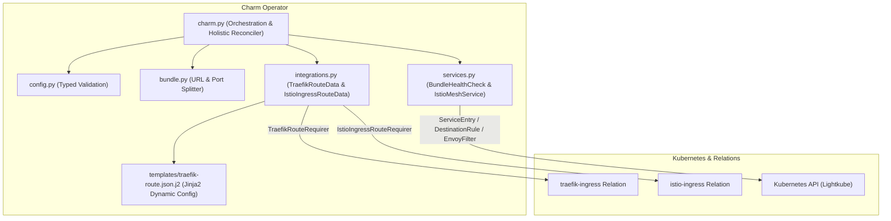

# Design

## Context

See `proposal.md` for motivation and background.

The operator is transformed from a Pebble-orchestrated workload container charm into a pure Kubernetes-native operator following Canonical Identity Team's 3-layer charm architecture. The operator configures ingress gateways (Traefik or Istio) to route client HTTP traffic directly to a pre-compiled Next.js static bundle hosted in S3-compatible object storage.

## Architecture & Reconciler Design

## Modular Decomposition

The codebase is structured into focused Python modules aligned with the 3-layer charm pattern:

- `src/charm.py`: Lifecycle event handling, status updates, and central reconciliation loop (`_holistic_handler()`).
- `src/config.py`: Typed configuration parsing, validation, and error reporting (`CharmConfig`).
- `src/bundle.py`: URL parsing, hostname/port extraction, and bundle path resolution logic (`BundleUrl`).
- `src/integrations.py`: Relation data wrappers and configuration builders (`TraefikRouteData`, `IstioIngressRouteData`).
- `src/services.py`: S3 bundle reachability checking (`BundleHealthCheck`) and `lightkube` Istio resource manager (`IstioMeshService`).
- `src/utils.py`: Reusable decorator utilities (`leader_unit`).
- `templates/traefik-route.json.j2`: Jinja2 template for Traefik dynamic configuration.

## Key Decisions

### Decision 1: Pure Operator Architecture without Workload Containers

- **Rationale**: The Next.js frontend application is static HTML/CSS/JS. Serving static files directly from S3 via Ingress gateways avoids maintaining redundant Nginx/HTTP server workload containers in the charm pod, reducing resource usage and operational overhead.
- **Alternatives Considered**: Running an Nginx/Caddy container managed via Pebble. Rejected because it introduces unnecessary container hops, pod overhead, and additional maintenance.

### Decision 2: Traefik Dynamic Configuration via `traefik_route` and Jinja2 Template

- **Rationale**: Traefik supports dynamic configuration submitted via the `traefik_route` relation library (`raw=True`). The charm renders `templates/traefik-route.json.j2` defining five routers (`redirect`, `root`, `page-slash-redirect`, `page`, `asset`) with `passHostHeader: false`, custom `replacePathRegex` / `replacePath` middlewares, custom `404.html` error handling (`errors` middleware), and security response headers (`headers` middleware).
- **Alternatives Considered**: Direct Traefik IngressRoute CRD creation. Rejected because using the standard charm relation library (`traefik_route`) ensures proper integration with Canonical's Traefik K8s charm.

### Decision 3: Istio Route Declaration + `lightkube` for Egress CRDs

- **Rationale**: The `charmlibs-interfaces-istio-ingress-route` (`1.0.2`) library supports declaring public `HTTPRoute` rules using `BackendRef(service, port)`, `URLRewriteFilter`, and `RequestRedirectFilter` (with optional `hostnames`), where `istio-ingress-k8s` resolves `BackendRef.service` as `<service>.<namespace>.svc.cluster.local` and Kubernetes Gateway API `HTTPRoute` does not natively support regex capture group substitution. Therefore, the charm uses `IstioIngressRouteData` to publish public HTTP routes targeting `<app>-s3-external` while `IstioMeshService` manages the `<app>-s3-external.<namespace>.svc.cluster.local` `ServiceEntry`, `DestinationRule`, and `<app>-ui-rewrite` `EnvoyFilter` (regex rewrites, `:authority` override, and security response headers) directly using `lightkube`.
- **Alternatives Considered**: Inventing dummy Kubernetes Services to pass to `BackendRef`. Rejected because creating fake services violates Istio specifications and creates non-functional backends.

### Decision 4: Egress Proxy Support (PS6 Direct vs PS7 Proxy Tunnel)

- **Rationale**: When `istio-egress-proxy` is unset (PS6), direct `ServiceEntry` (`<app>-s3-external.<namespace>.svc.cluster.local`, protocol `HTTPS` on `bundle.port` with `dnsName: bundle.hostname`), `DestinationRule` (TLS SIMPLE with SNI set to `bundle.hostname`), and `<app>-ui-rewrite` `EnvoyFilter` are created. When `istio-egress-proxy` is set (PS7), a `ServiceEntry` targeting `<app>-s3-external.<namespace>.svc.cluster.local` on port `15999`, a `DestinationRule` originating TLS with SNI set to the real S3 hostname, the `<app>-ui-rewrite` `EnvoyFilter`, and a `<app>-proxy-tunnel` `EnvoyFilter` with both `LISTENER` (`127.0.0.1:15999` HTTP CONNECT tunnel) and `CLUSTER` (`LOGICAL_DNS` upstream proxy endpoint) patches are created.
- **Alternatives Considered**: Forcing external proxies for all deployments. Rejected because direct S3 egress (PS6) is the standard deployment pattern when no egress HTTP proxy is required.

## Risks & Trade-offs

| Risk | Mitigation |
| :--- | :--- |
| **Provider-side Istio Compatibility**: `istio-ingress-k8s` provider may fail to route traffic if `BackendRef` requires an existing K8s Service. | Mandatory provider compatibility integration test required before Istio feature sign-off. |
| **Missing Juju Trust**: Creating `ServiceEntry`/`DestinationRule` via `lightkube` fails if `juju deploy --trust` was not executed. | Catch `lightkube.core.exceptions.ApiError` (HTTP 403) and enter `BlockedStatus` with an explicit message advising `juju trust`. |
| **Port Collision for PS7 Tunnel**: Proxy tunnel uses fixed loopback port `15999`. | Only one charm instance per Istio gateway is supported in this iteration. Document limitation in release notes. |

## Observability & Health Checking

- **Health Check**: Perform HTTP HEAD requests to `/index.html` from the charm container using `requests`, honouring `JUJU_CHARM_HTTPS_PROXY` and `JUJU_CHARM_HTTP_PROXY`.
- **Diagnostics**: Detail exact failures in unit status logs.

## Migration & Rollout Plan

1. Remove old Pebble container definitions and workload relations from `charmcraft.yaml`.
2. Deploy updated charm with `juju deploy --trust`.
3. Configure `ui-bundle-url` and relate to `traefik-ingress` or `istio-ingress`.
4. Verify HTTP traffic flow to `/ui/` and check charm unit status is `ActiveStatus`.
